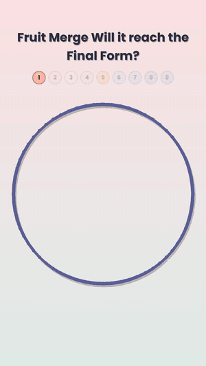
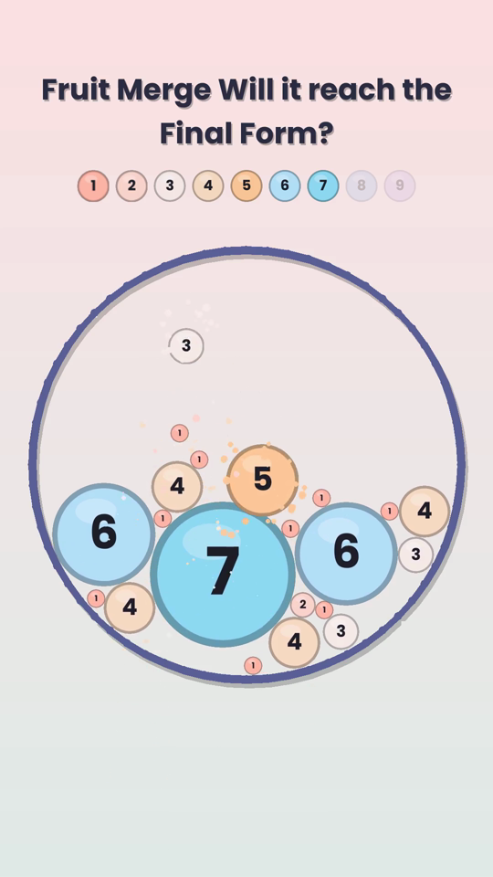
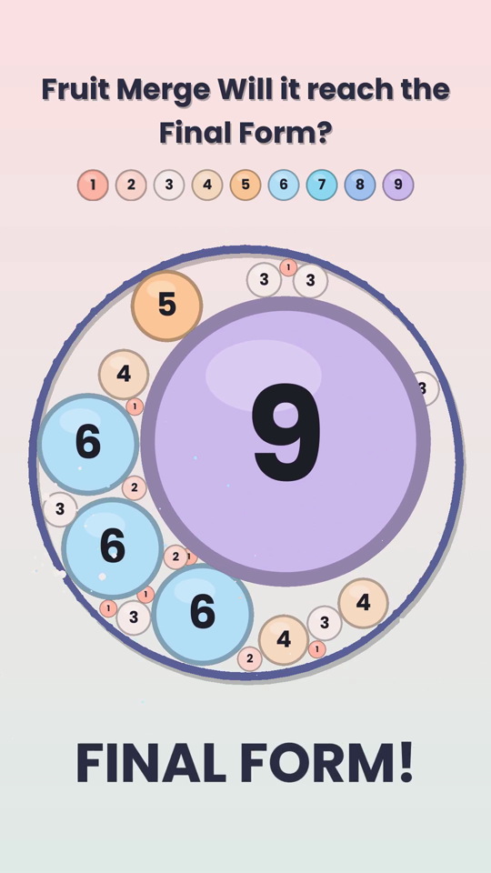
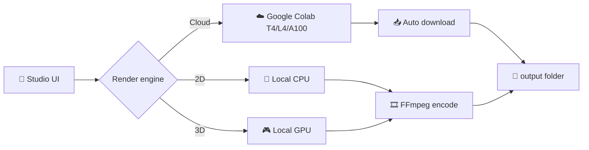

<div align="center">


# Money Maker 911

### The all-in-one Windows studio for faceless, satisfying physics Shorts

**2D + 3D simulation modes · one-click batch rendering · local PC or Google Colab GPU**


**1080×1920 · 60 fps · YouTube Shorts / TikTok / Reels ready**

**[⬇️ Download the portable .exe](https://github.com/TeamRealHacker/money-maker-911/releases/tag/nightly)**

[Progress](#-progress) · [Features](#-features) · [Modes](#-simulation-modes) · [Install](#-install-windows) · [Colab GPU](#%EF%B8%8F-google-colab-gpu-rendering) · [Roadmap](#%EF%B8%8F-roadmap)

</div>

---

## 🚀 Progress

<div align="center">

&nbsp;&nbsp;

&nbsp;&nbsp;


*Real output from the engine: 🍉 Merge Evolution, Candy palette, seed 2 (demo GIF sped up 2.5×)*
</div>

| Area | Status |
|------|--------|
| 🍉 Merge Evolution | ✅ **Working** (6 palettes, 6 shapes, spin, particles, Final Form ending) |
| 🔊 Drop-in sound + auto pitch | ✅ Working (any mp3/wav/ogg, built-in pop) |
| 🏭 Batch factory + titles.csv | ✅ Working (anti-repeat rotation, "only wins" seed search) |
| 🖥️ Desktop app | ✅ Splash, onboarding, live preview, inspector |
| 📦 Portable .exe | ✅ Built by GitHub Actions → [Nightly release](https://github.com/TeamRealHacker/money-maker-911/releases/tag/nightly) |
| 🖼️ AI cut-outs | 🔜 Next |
| 🌀 Other 2D modes | 🔜 One by one |
| ☁️ Colab rendering | 🔜 Planned |
| 🔵 3D modes | 🔜 Planned |

Full log: [docs/PROGRESS.md](docs/PROGRESS.md)

---

## ✨ What is Money Maker 911?

Money Maker 911 turns **one click into dozens of finished Shorts**. Pick a mode, pick a theme, drop in your images and one sound, and it simulates, records and exports ready-to-upload vertical videos, with titles and hashtags written for you.

Everything it can do in one place:

- 🎮 **29+ simulation modes**: 17 classic ball-physics formats plus 12 new ones
- 🖥️ **Render on your own PC** (CPU or NVIDIA/AMD/Intel GPU)
- ☁️ **Or render in the cloud on Google Colab T4 / L4 / A100**, fully automatic
- 🔁 **Batch factory**: queue 10, 50 or 100+ unique videos at once
- 🎨 **Your own look**: no neon presets forced, every color, shape, font and speed editable
- 🔊 **Drop-in sound** (Myinstants or any file): auto pitch per tier, per hit
- 🖼️ **Clean meme cut-outs**: built-in AI background removal, no captions
- 🧠 **Anti-repeat engine**: every video comes out different, so channels stay fresh

> 🚧 **Status:** active development. 🍉 Merge mode works today; the other modes land one by one. See [Progress](#-progress).

---

## 🎬 Simulation Modes

### 🟢 2D Modes (run fast on any PC)

| # | Mode | What happens | Hook example |
|---|------|--------------|--------------|
| 1 | 🍉 **Merge Evolution** | Items drop into a ring and merge up tiers until the Final Form | *"Will it reach the Final Form?"* |
| 2 | 🌀 **Escape** | A ball bounces inside spinning rings with gaps and tries to escape | *"How fast can it escape?"* |
| 3 | 🎵 **Rhythmic** | Every bounce plays the next note of a melody | *"Recognize this melody?"* |
| 4 | ✏️ **Drawer** | The ball leaves a trail that draws a hidden picture | *"You know this one?"* |
| 5 | ➕ **Accumulate** | Every bounce spawns a new ball until the screen fills | *"How many until it overflows?"* |
| 6 | 👻 **Ghost Escape** | Dodge a ring of spikes that closes in | *"Can it dodge the trap?"* |
| 7 | 🧱 **Breaker** | Balls smash through layered walls | *"Will the wall break?"* |
| 8 | 🏢 **Glass Tower** | Balls crash down a tower of glass floors | *"How many floors survive?"* |
| 9 | 🚩 **Flag Battle** | Country/team balls fight for territory | *"Which country wins?"* |
| 10 | ⚔️ **Weapon Ball Battle** | Balls with swords, shields and HP bars fight to the last one | *"Who survives?"* |
| 11 | 🥛 **Glass Rush** | Rings of glass crack layer by layer | *"Will the glass hold?"* |
| 12 | 🏁 **Race** *(new)* | Balls race down a randomized obstacle course | *"Pick your winner!"* |
| 13 | 🎯 **Plinko** *(new)* | Balls drop through pegs into prize slots | *"Where will it land?"* |
| 14 | 🧲 **Gravity Flip** *(new)* | Gravity rotates every few seconds | *"Can it stay inside?"* |
| 15 | 🐍 **Snake Grow** *(new)* | A ball grows with every hit until it fills the arena | *"How big can it get?"* |
| 16 | 💥 **Chain Reaction** *(new)* | One hit sets off a domino of explosions | *"Watch it all go!"* |
| 17 | 🔢 **Countdown Survival** *(new)* | Last ball standing before the timer hits 0 | *"Will anyone survive 30s?"* |
| 18 | 🧩 **Color Sort** *(new)* | Balls sort themselves into matching tubes | *"So satisfying…"* |
| 19 | 🗳️ **Voting / Elimination** *(new)* | Viewers' picks battle in brackets | *"Comment who wins"* |

### 🔵 3D Modes (best on an NVIDIA GPU or Colab)

| # | Mode | What happens |
|---|------|--------------|
| 20 | 🌊 **Wave 3D** | Thousands of glowing spheres form a moving wave funnel |
| 21 | 🎢 **Marble Run 3D** | A marble rolls down a procedurally built track |
| 22 | 🏋️ **Ball Crush 3D** | Heavy weights crush piles of balls, with a kg counter |
| 23 | 🍮 **Jelly 3D** | Soft-body jelly drops through layers, with a % solid meter |
| 24 | 🔪 **Cut Count 3D** | Objects get sliced again and again, with a cut counter |
| 25 | 🧲 **Magnet 3D** | A magnet pulls thousands of steel balls, power multiplier |
| 26 | 🏗️ **Hydraulic Press 3D** *(new)* | Press vs everyday objects |
| 27 | 🫧 **Liquid Pour 3D** *(new)* | Fluid fills shapes and containers |
| 28 | 🧊 **Shatter 3D** *(new)* | Objects explode into physics fragments |
| 29 | 🪙 **Coin Pusher 3D** *(new)* | Arcade coin pusher, will the stack fall? |

> All mechanics and visuals are built from scratch for Money Maker 911. No third-party app code or assets are copied.

---

## 🧰 Features

### 🎨 Studio & Customization
- Live preview at 60 fps while you edit
- Custom container shapes: circle, hexagon, star, heart, square, triangle, custom SVG
- Full color control: background, container, trails, particles, text (no forced neon)
- Backgrounds: solid, gradient, image, looping video, blur, parallax
- Fonts: any Google Font or local `.ttf`
- Speed, gravity, bounciness, friction, ball size and count sliders
- Hook text on top, counter/timer in the middle, watermark at the bottom, each editable
- Emoji and text tiers (🥚 → 🐣 → 🐔 → 🦅 …)
- Saveable **themes and presets**, plus import/export to share them

### 🖼️ Images & Meme Cut-outs
- Drag in any images or a whole folder for tiers and balls
- **Built-in AI background removal** (BiRefNet / ISNet / U²-Net via ONNX, runs offline)
- Auto crop, auto circle-mask, outline and drop-shadow
- Caption remover: rejects or crops out images that contain text
- Meme finder helpers: GIPHY search (free key) and bulk folder import

### 🔊 Sound
- Drop in **any sound file**: Myinstants clips, your own recordings, `.mp3 / .wav / .ogg`
- **Auto pitch** per tier, per bounce, per merge (rising pitch = more satisfying)
- Melody mode: import a MIDI file and every hit plays the next note
- Volume, reverb and random pitch-jitter so no two videos sound the same
- Optional background music slot (off by default)

### 🏭 Batch Factory
- Queue **10 / 50 / 100+ videos** in one go
- Randomize per video: theme, shape, colors, background, hook, speed, seed
- Seed control: re-render any video exactly the same
- Auto-skip boring runs (e.g. Merge that never reaches the final tier)
- Auto file names, plus a CSV of titles, descriptions and hashtags for every video
- Title templates like `[Theme] Merge [emoji] Will it reach the Final Form? #shorts`

### 🧠 Anti-Repeat Engine (YouTube-friendly)
- Rotates layouts, palettes, shapes, hooks and endings across a batch
- Duplicate checker flags videos that look too similar
- Warns when you use real people, logos or copyrighted clips

### 🎞️ Export
- 1080×1920 vertical, 60 fps (also 30 fps, 1080×1080, 1920×1080)
- H.264 / H.265 / AV1 via FFmpeg
- Hardware encoding: **NVIDIA NVENC**, AMD AMF, Intel QSV
- Length presets: 15 s, 30 s, 45 s, 60 s, or "until finished"
- Optional thumbnail frame export

### 📤 Publishing (planned)
- YouTube Data API upload with title, description, tags and schedule
- Upload queue: spread videos across days automatically
- Multi-channel profiles

---

## 🖥️ Render Engines

Money Maker 911 can render in three places. Pick per batch.

| Engine | Best for | Needs |
|--------|----------|-------|
| 🧮 **Local CPU** | All 2D modes | Any modern PC, 8 GB RAM |
| 🎮 **Local GPU** | 3D modes, fast 2D batches | NVIDIA (GTX 1650+ / RTX), AMD or Intel GPU |
| ☁️ **Google Colab** | Huge batches, heavy 3D, weak PCs | Free or Pro Google account |



---

## ☁️ Google Colab GPU Rendering

Money Maker 911 uses the official **[Google Colab CLI](https://github.com/googlecolab/google-colab-cli)** (`google-colab-cli`) to rent a Colab GPU, render your batch, download the videos and shut the GPU down, all automatically.

### How it works
1. You press **Render on Colab** and choose a GPU (T4 on free, L4/A100 on Pro).
2. The app packs your project (scene settings, images, sounds) into a job file.
3. It creates a session: `colab new -s mm911 --gpu T4`
4. Uploads the job, installs the renderer: `colab upload` and `colab install`
5. Runs the render notebook: `colab exec -s mm911 -f render.ipynb`
6. Downloads every finished video: `colab download`
7. Stops the session to save your quota: `colab stop -s mm911`

Your login is saved, so you sign in once and every render after that is one click. Colab CLI keeps its session tokens in `~/.config/colab-cli/sessions.json`. The app never uploads your tokens anywhere else.

### ⚠️ Windows note
The Colab CLI officially supports **Linux and macOS only**. On Windows, Money Maker 911 runs it inside **WSL2 (Ubuntu)** for you. Setup is a one-time step:

```powershell
# 1. Install WSL2 with Ubuntu (PowerShell as Administrator), then restart
wsl --install -d Ubuntu
```

```bash
# 2. Inside Ubuntu: install the Colab CLI
sudo apt update && sudo apt install -y python3-pip pipx
pipx install google-colab-cli

# 3. Sign in to Google (opens your browser; default auth is ADC)
#    Install the gcloud CLI first: https://cloud.google.com/sdk/docs/install
gcloud auth application-default login

# 4. Test a T4 GPU
colab new -s test --gpu T4
echo '!nvidia-smi' | colab exec -s test
colab stop -s test
```

After that, Money Maker 911 detects WSL + Colab CLI automatically and shows **☁️ Colab ready** in the status bar.

### Colab limits to know
- Free tier GPUs are not guaranteed and sessions time out. The app retries and resumes unfinished videos.
- Use `colab usage` (or the app's quota panel) to check compute units on Pro.
- Follow [Colab's Terms of Service](https://research.google.com/colaboratory/tos_v6.html).

---

## 💻 Install (Windows)

### Requirements
| | Minimum | Recommended |
|---|---|---|
| OS | Windows 10 64-bit | Windows 11 |
| CPU | 4 cores | 8+ cores |
| RAM | 8 GB | 16 GB+ |
| GPU (2D) | Any | Any |
| GPU (3D) | GTX 1650 / 4 GB VRAM | RTX 3060+ / 8 GB VRAM |
| Disk | 5 GB free | SSD, 50 GB+ for batches |

### Option A: Portable .exe (no install)
1. Download **`MoneyMaker911.exe`** from the [Nightly release](https://github.com/TeamRealHacker/money-maker-911/releases/tag/nightly).
2. Double-click it. FFmpeg is bundled.
3. If Windows SmartScreen shows a warning, click **More info → Run anyway** (the app isn't code-signed yet).

> Needs Microsoft Edge WebView2, which Windows 10/11 already include.

Command line works too:
```powershell
MoneyMaker911.exe render --preset presets\fruit_candy.json --out output\merge.mp4
MoneyMaker911.exe batch --count 20 --out output
```

### Option B: Run from source
```powershell
winget install Python.Python.3.12
git clone https://github.com/TeamRealHacker/money-maker-911.git
cd money-maker-911
pip install -r requirements.txt
python main.py            # desktop app
python main.py batch --count 10 --out output
```

### Using your PC for 3D
1. Update your GPU driver (NVIDIA Game Ready / Studio, AMD Adrenalin, Intel Arc).
2. In **Settings → Render**, pick **Local GPU** and your graphics card.
3. Turn on **Hardware encoding (NVENC/AMF/QSV)** for much faster exports.
4. Weak GPU? Lower **3D quality** to *Fast*, or send the batch to **Colab**.

---

## 🏗️ Tech Stack

| Part | Tech |
|------|------|
| App shell | Python 3.12 + pywebview (Edge WebView2, tiny and fast) |
| UI | HTML/CSS/JS, Apple-style |
| 2D physics | pymunk (Chipmunk2D) |
| Rendering | pygame-ce offscreen, 3× supersampled sprites |
| 3D (planned) | GPU renderer, chosen when 3D work starts |
| Encoding | FFmpeg (x264 / NVENC / AMF / QSV, auto-detected) |
| Background removal | rembg + BiRefNet / ISNet / U²-Net (planned) |
| Packaging | PyInstaller → one portable .exe via GitHub Actions |
| Cloud | Google Colab CLI via WSL2 (planned) |

### 📁 Project structure
```
money-maker-911/
├─ main.py              # app + CLI entry
├─ mm911/
│  ├─ config.py         # every editable setting, palettes, hooks
│  ├─ render.py         # renderer + FFmpeg export
│  ├─ audio.py          # sound loading, pitch, mixing
│  ├─ batch.py          # batch factory + titles.csv
│  ├─ modes/merge.py    # 🍉 Merge Evolution physics
│  ├─ gui/              # desktop app (splash, onboarding, studio)
│  └─ assets/           # logo, fonts (Poppins, OFL)
├─ presets/             # ready-made looks
├─ docs/                # demo + progress log
└─ .github/workflows/   # portable .exe build
```

---

## 🗺️ Roadmap

- [x] Project plan and repository
- [x] **Phase 1: Core engine** (physics, renderer, audio pitch, FFmpeg export)
- [x] **Phase 2: 🍉 Merge Evolution** (first full mode + studio UI)
- [x] **Phase 3: Batch factory** + title/hashtag CSV + anti-repeat rotation
- [ ] **Phase 4: AI cut-outs** + image/meme import
- [ ] **Phase 5: Escape, Breaker, Glass Rush, Ghost Escape, Rhythmic**
- [ ] **Phase 6: Battle modes** (Flag, Weapon) + remaining 2D modes
- [ ] **Phase 7: ☁️ Colab GPU rendering** (WSL2 bridge)
- [ ] **Phase 8: 3D modes** (Wave, Marble Run, Ball Crush, Jelly, Cut Count, Magnet)
- [ ] **Phase 9: New 3D modes** + YouTube auto-upload
- [x] Portable .exe via GitHub Actions
- [ ] **Phase 10: Windows installer** + auto-update

---

## ⚖️ Content & Copyright Tips

- Use sounds and images you have the right to use. Clips cut from songs, movies or TV can get **Content ID claims**.
- Avoid real people's faces and club/brand logos in monetized videos.
- YouTube can demonetize "mass-produced or repetitive" content. Use the anti-repeat engine and vary your themes.
- For commercial use of AI cut-outs, stick to the bundled BiRefNet / ISNet / U²-Net models.

---

## 🤝 Contributing

Ideas, bug reports and new mode concepts are welcome. Open an **Issue** or a **Pull Request**.

## 📜 License

[MIT](LICENSE) © 2026 TeamRealHacker

<div align="center">

**Made for creators who'd rather render than record.**

<sub>made by TeamRealHackers</sub>

⭐ Star the repo to follow progress!

</div>
